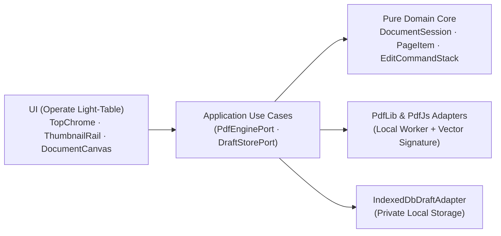

# PdfCraft Studio

Editor de PDF privado **100% local-first en navegador**: abre o une archivos PDF, reordena/rota/duplica/elimina páginas, estampa firma manuscrita o texto y descarga el binario final sin subir documentos a ningún servidor (`0 KB enviados a la red`).

- **Demo en vivo:** https://danieldiaz54.github.io/pdfcraft-studio/
- **Caso #1 del Portafolio V2:** Arquitectura **Hexagonal Local-First** (`TypeScript` estricto + `React 19` + `pdf-lib` + `pdfjs-dist` + `IndexedDB`).



## Capacidades Principales
1. **Inicio instantáneo:** Arrastra tus PDFs o carga **"Contrato_Servicios_2026.pdf"** (contrato real de 4 páginas generado localmente).
2. **Edición real:** Reordena páginas arrastrando miniaturas, rota `±90°`, duplica, borra y deshaz/rehace con `Ctrl+Z` / `Ctrl+Y`.
3. **Firma manuscrita vectorial y anotaciones:** Dibuja tu firma en lienzo táctil y muévela sobre la hoja A4.
4. **Fusión multi-PDF y exportación real:** Une documentos adicionales y descarga el `.pdf` resultante compilado en tu equipo.
5. **Capa 2 técnica opcional:** Abre el cajón `"Arquitectura"` para auditar la estructura hexagonal y el historial de comandos ejecutados.

## Ejecución y Verificación Local
```bash
npm install
npm run lint
npm run typecheck
npm test
npm run build
python -m unittest discover -s tests -v
```
